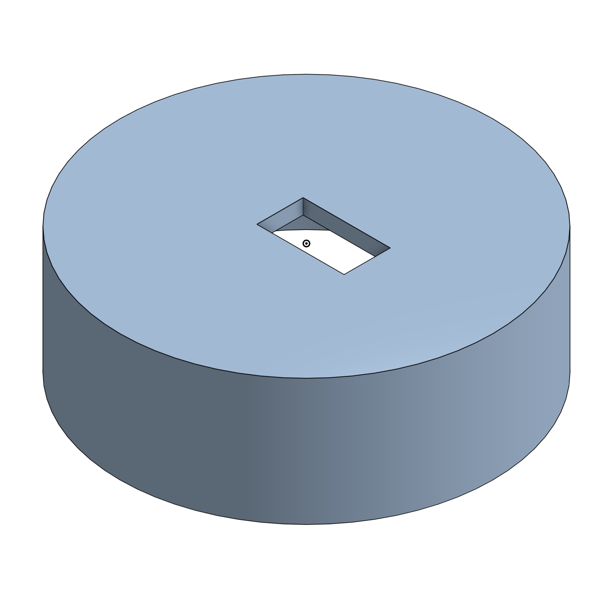
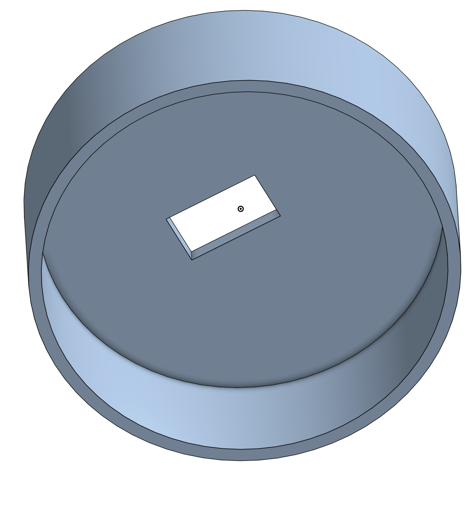
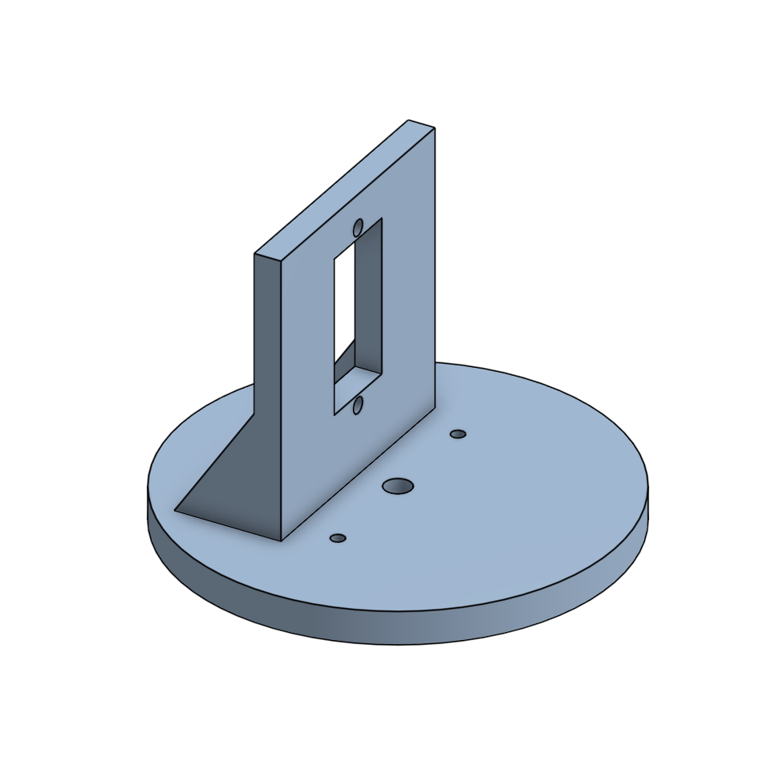
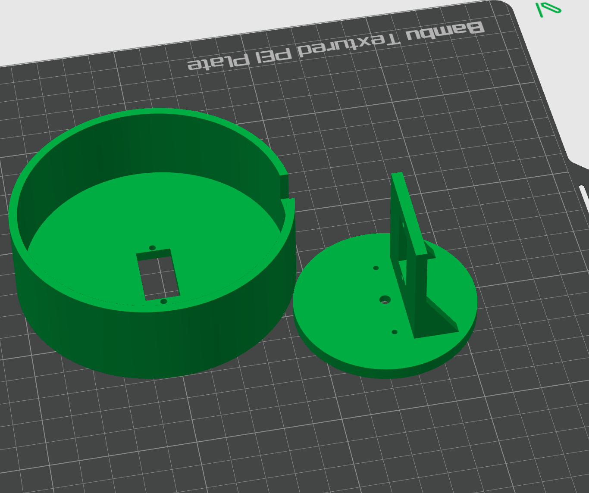
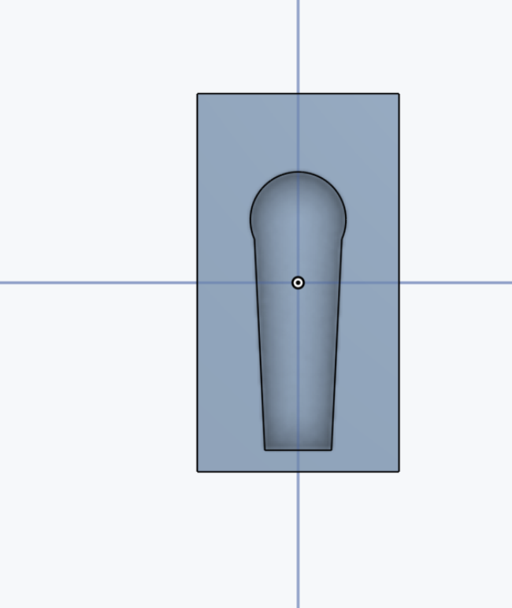
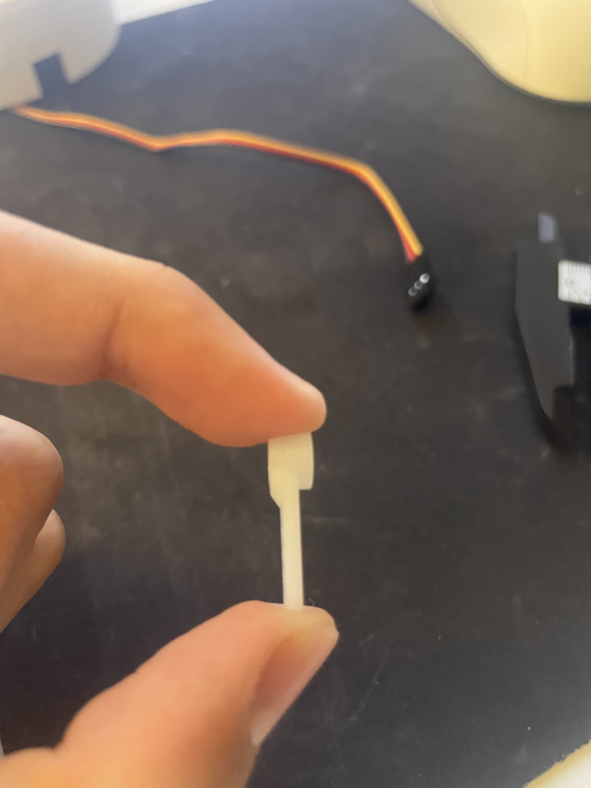
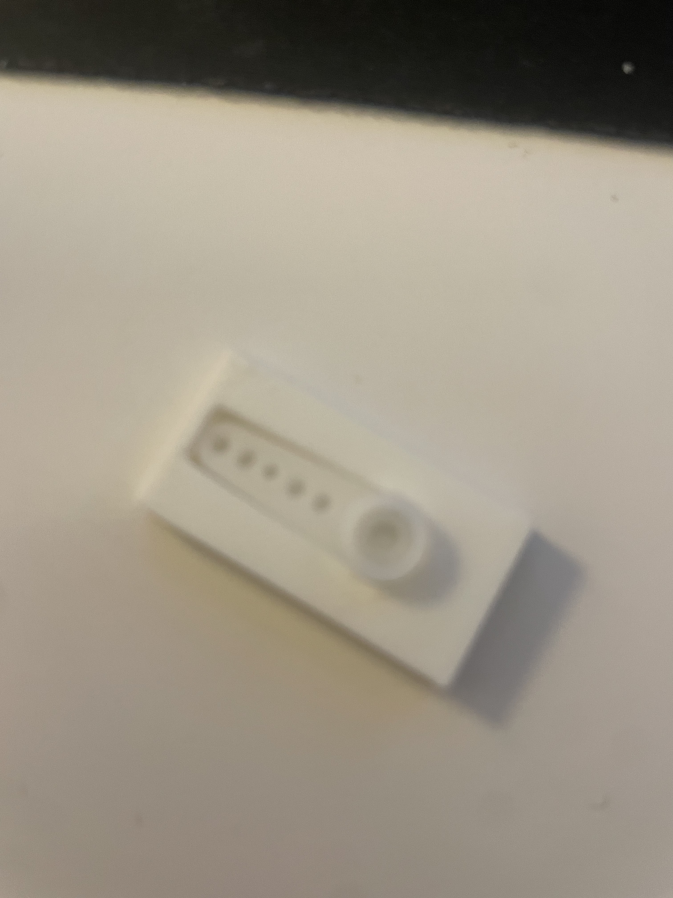
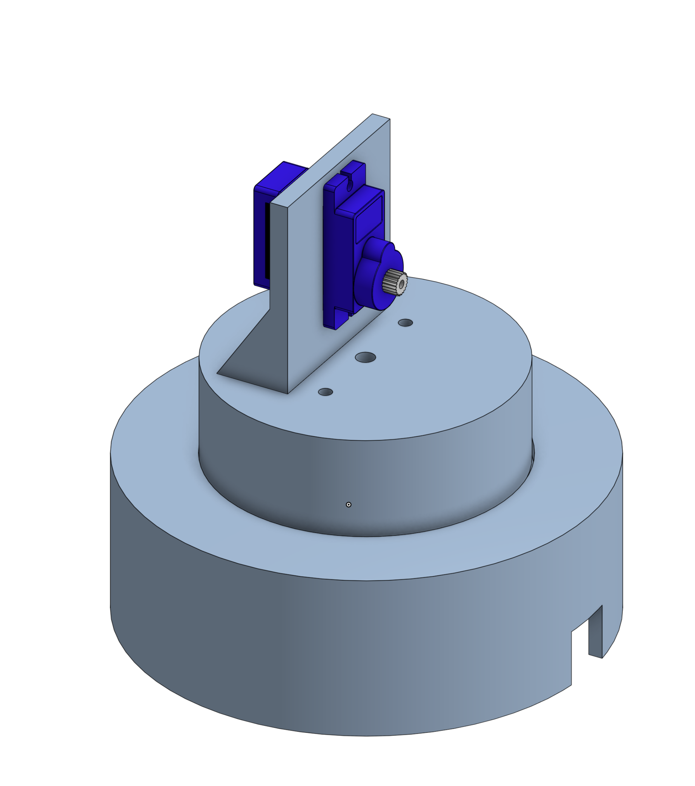
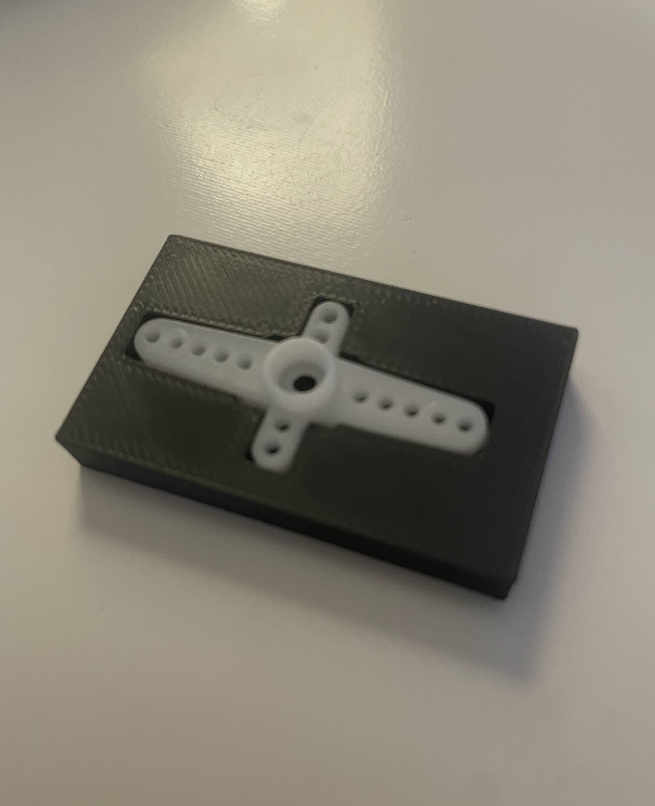

---
SG90 Robot Arm
Oliver Ueno
Designing, printing, and testing an SG90 robot arm.
2026-07-24
---

# July 24, 2026: Designing the fixed base

I tested the servos and picked four that actually worked well and had no major imperfections. After that, I started with a servo fit gauge to see how the servo would fit on the main design. The first design was too loose, so I measured the servo body again and got about 23.1 by 12.1 mm. 

Finally, I changed the opening and tried another print, and it worked.
I also made the fixed base in Onshape. It's 100 mm in diameter, with an opening for the servo and hollowed out underneath. The outside wall to help support the base is 30 mm tall.

**Total time spent: 1 hour**

# July 25, 2026: Designing the rotating shoulder mount

Today was working on the smaller platform that  rotates above the fixed base in CAD. I measured the servo horn and made a test piece.

After that, I realized I'd been measuring some hole positions from the edge instead of the centre, which was why they weren't lining up properly. I made an upright wall for the shoulder servo and added some support behind it. The wall has an opening for a servo and two holes to actually mount the servo.

**Total time spent: 1.5 hours**

# July 26, 2026: Preparing the base parts for printing

Today, I started off by putting the fixed base and rotating shoulder platform into the 3d printing slicer. I checked the infill amount and then sent the parts to print.

I was wondering whether the servos would actually be able to move the rotating platform with the other servos and pieces on it due to the weight, but I haven't actually tested the finished arm, so if that becomes an issue, I'll have to redesign.

**Total time spent: 30 minutes**

# September 18, 2026: Making the single-arm horn gauge
I took a pretty big break between July and September. I didn't do much work at all, so I continued where I left off, by getting the base parts printed and then assembling them. 

Some holes needed adjusting as they weren't lined up properly, and I couldn't quite fit a nut beneath the servo screw hole. I worked on a fit gauge for the shoulder servo horn that will eventually connect to the upper arm. Overall, I think I did a pretty good job picking things up, but I'll need to pick up the pace.

**Total time spent: 45 minutes**

# September 19, 2026: Checking the horn fit

Today I tried making the servo horn pocket on the fit gauge deeper because the horn wasn't sitting properly. Even when it was 3.3 mm deep, it had some issues, and it wasn't quite stable to my liking.

I took side photos to show the thicker connector and the thinner arm. Making the whole pocket deeper hadn't fixed the uneven support. In summary, I need to fix the fitting gauge for the shoulder joint, but I might start working on redesigning the base later, as I realized it was poorly designed.

**Total time spent: 35 minutes**

# September 20, 2026: Adding mounting holes to the gauge
I measured from the centre of the hole where the connection is to two small holes along the horn. I got a measurement of 5.5 mm to the nearest one and 15.2 mm to the farthest hole. After that, I used that info for the holes in the fit gauge and chose 2.8 mm diameter holes for the  screws, based on the measurements I'd used before.

Moving on, I sent the gauge to print and worked on the journal while waiting. I still need to check the fit and screw connection before saying this version works. I'll probably start the base redesign next log.

**Total time spent: 40 minutes**

# October 15, 2026: Redesigning the base support
Today I started redesigning the base as I mentioned previously, because I was worried about the base servo supporting all of the weight on just one focal point, especially as it has plastic gears. I looked at a few ideas to redesign the base, and after a bit of thinking, I decided that the idea is for the walls of the rotating piece to rest in a groove and distribute the weight evenly, instead of having to leave the platform supported only by the one base servo. 

The groove is 4 mm deep, and the wall has a 65 mm outer diameter and a 58 mm inner diameter.  I worked on a smaller fitting test so that I wouldn't need to reprint a whole base just to check the groove. OveraI haven't confirmed the printed fit yet, and I'm still concerned about how much friction the base servo will have to withstand. I also might design a pocket underneath the rotating platform to help with stability and overall support.

**Total time spent: 1 hour**

# October 18, 2026: Designing the base horn pocket

I started by realizing that a pocket underneath the rotating part would greatly benefit the overall weight distribution and would also help support the base servo. I then got to work and started taking the measurements of the cross-shaped servo horn, and had to pretty much take every measurement of it, including a weird shape on the top that tapers up in thickness. After I had all my measurements, I started designing the fit gauge in CAD. It was a pretty simple task, as I just engraved the cross shape into a rectangle and then sent it off to the printer.

After the print was done, I tested it by putting the cross-shaped servo horn into the fit gauge, and it fit perfectly. I can now start designing and printing the (probably) final design of the base.

Total time spent: 45 minutes
